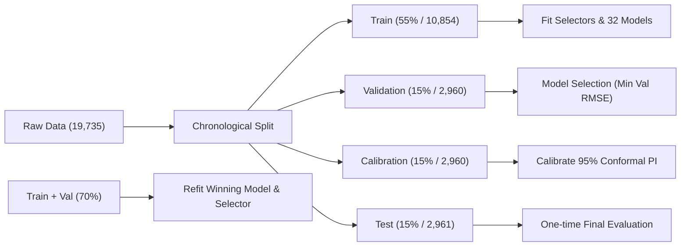

# Appliance Energy Prediction: Feature Selection × Loss Functions

> A reproducible CRISP-DM machine learning project comparing **7 feature-selection strategies**, **4 linear regression loss objectives**, and an unselected baseline on Kaggle's *Appliances Energy Prediction* dataset.

[](https://share.streamlit.io)
[](https://www.python.org/downloads/)
[](https://opensource.org/licenses/MIT)

**Status:** Full 32-model experiment completed · All 8 static figures & metric CSVs generated · Serialized best model saved · Streamlit Cloud standalone ready.

---

## 1. Project Overview & Research Questions

This project is not simply about achieving the lowest regression error. Its primary purpose is to **systematically evaluate and visualize**:
1. **Information Selection (Feature Selection)**: How 7 distinct feature selection algorithms (Filters, Wrappers, Embedded) decide which subsets of variables enter the linear model.
2. **Residual Penalization (Loss Functions)**: How 4 regression objectives (Squared Error, Huber Loss, Absolute L1 Loss, Epsilon-insensitive Loss) handle prediction errors, skewness, and extreme appliance energy spikes.
3. **Synergy**: Which Feature Selection × Loss Function combination yields the best predictive performance on unseen chronological data.
4. **Parsimony**: Whether selecting 15 key features outperforms using all 27 candidate features.
5. **Uncertainty Quantification**: Calibrating a valid **95% Conformal Prediction Interval** on independent calibration data and evaluating held-out coverage.

---

## 2. Dataset & Candidate Features

- **Source**: [Kaggle — Appliances Energy Prediction Dataset](https://www.kaggle.com/datasets/loveall/appliances-energy-prediction) / [UCI Machine Learning Repository](https://archive.ics.uci.edu/dataset/374/appliances+energy+prediction)
- **Observations**: 19,735 records sampled every 10 minutes (~4.5 months of continuous time series).
- **Target**: `Appliances` (Wh) — represents total household appliance energy consumption (strongly right-skewed with heavy consumption spikes).
- **Temporal Sorting**: `date` is strictly used for chronological ordering and is excluded from model feature matrices.
- **Candidate Predictors**: All **27 numerical features** from the raw dataset are used as candidates without manual pre-filtering:
  - **Indoor Environmental Conditions**: `T1`, `RH_1` (Kitchen), `T2`, `RH_2` (Living room), `T3`, `RH_3` (Laundry), `T4`, `RH_4` (Office), `T5`, `RH_5` (Bathroom), `T6`, `RH_6` (Outside north), `T7`, `RH_7` (Ironing room), `T8`, `RH_8` (Teenager room), `T9`, `RH_9` (Parents room).
  - **Outdoor Weather Station**: `T_out` (Temperature), `Press_mm_hg` (Pressure), `RH_out` (Humidity), `Windspeed`, `Visibility`, `Tdewpoint`.
  - **Sub-metered / Random**: `lights` (Lighting energy), `rv1`, `rv2` (Random variables).

---

## 3. Experimental Design (8 Selectors × 4 Losses = 32 Configurations)

### Feature Selection Strategies (K = 15 Selected Features)

| ID | Method | Type | Description & Controls |
|:---:|---|:---:|---|
| **FS0** | **Baseline (No Selection)** | Baseline | Retains all **27 numeric features** as the benchmark. |
| **FS1** | **Pearson Correlation** | Filter | Ranks features by absolute linear correlation $\|r(X_i, y)\|$; selects Top 15. |
| **FS2** | **F-test (SelectKBest)** | Filter | Univariate linear regression F-statistic test; selects Top 15. |
| **FS3** | **Mutual Information** | Filter | Non-parametric k-NN statistical dependence; fitted on standardized inputs. |
| **FS4** | **Recursive Feature Elimination (RFE)** | Wrapper | Greedily prunes lowest-weighted features with standardized OLS regression. |
| **FS5** | **Forward SFS** | Wrapper | Greedy forward selection with 3-fold `TimeSeriesSplit` cross-validation. |
| **FS6** | **Backward SFS** | Wrapper | Backward elimination from 27 features with 3-fold `TimeSeriesSplit` CV. |
| **FS7** | **LassoCV Ranking** | Embedded | L1-regularized path over 3-fold `TimeSeriesSplit`; ranked by standardized $\|coef_j\|$. |

### Linear Regression Objectives

| ID | Loss Objective | Estimator | Key Characteristic |
|:---:|---|---|---|
| **L1** | **Squared Error (OLS)** | `LinearRegression` | Penalizes residuals quadratically ($e^2$); optimal for Gaussian errors, sensitive to outlier spikes. |
| **L2** | **Huber Loss** | `HuberRegressor(alpha=1e-4)` | Quadratic for small residuals, linear for $\|e\| > \delta$; smooth compromise against outliers. |
| **L3** | **Absolute Error (Median)** | `QuantileRegressor(quantile=0.5)` | Estimates conditional median ($\|e\|$); highly robust to extreme power surges. |
| **L4** | **Epsilon-insensitive** | `SGDRegressor(loss='epsilon_insensitive')` | Ignores errors within a $\pm 5$ Wh tube; linear penalty outside the margin. |

*Note on comparability*: Different estimators utilize different numerical solvers (e.g. OLS normal equation vs. HiGHS linear programming vs. SGD) and default regularizations. All estimators are wrapped in a pipeline with `SimpleImputer(strategy='median')` and `StandardScaler()`.

---

## 4. CRISP-DM Workflow & Leakage-Safe Data Splitting



1. **Chronological Splitting**:
   - **Train (55%)**: 10,854 samples — Feature selection fitting & model training.
   - **Validation (15%)**: 2,960 samples — Model selection across all 32 combinations.
   - **Calibration (15%)**: 2,960 samples — Non-conformity score quantile calibration for 95% Prediction Interval.
   - **Test (15%)**: 2,961 samples — Untouched final evaluation of accuracy and interval coverage.
2. **Data Leakage Safeguards**:
   - Imputers and Scalers are fitted **only** on training data slices.
   - Feature selectors never observe validation, calibration, or test records.
   - Winner configuration is refit on `Train + Validation` before final testing.

---

## 5. Summary of Experimental Results

- **Validation RMSE Matrix & Ranking**:
  - `Squared Error (OLS)` achieves the lowest Validation RMSE (~94.4 Wh) because its loss aligns directly with the squared evaluation metric.
  - However, `Absolute Error (Median)` and `Huber` achieve **drastically better MAE (~43.3–44.3 Wh vs. ~58.6 Wh for OLS)**, demonstrating that robust loss functions predict typical baseline household energy with much greater precision by ignoring outlier spikes.
  - **Winning Model (Lowest Validation RMSE)**: **Pearson Correlation × Squared Error (OLS)** (`Val RMSE = 94.418 Wh`, `Val MAE = 58.646 Wh`).
- **Untouched Final Test Set Performance**:
  - **Test RMSE**: 88.308 Wh
  - **Test MAE**: 58.097 Wh
  - **Test $R^2$**: 0.0557
  - **Observed 95% Conformal Interval Coverage**: **94.5%** (Calibrated half-width: $\pm 145.15$ Wh; physical bounds clipped at 0).

---

## 6. Project Structure

```text
appliances-energy-feature-loss-comparison/
├── README.md                      # Comprehensive project documentation
├── requirements.txt               # Dependencies (Streamlit, Plotly, Scikit-learn, etc.)
├── .gitignore                     # Ignores venv, raw data/csv, caches
├── .streamlit/
│   └── config.toml                # Theme palette & typography
├── docs/
│   ├── SITE_ARCHITECTURE.md       # 5-page Streamlit navigation design
│   └── GITHUB_WORKFLOW.md         # Git commit conventions & deployment guide
├── data/
│   ├── README.md                  # Kaggle download instructions
│   └── energydata_complete.csv    # Local raw dataset (ignored by git)
├── src/
│   ├── __init__.py
│   ├── feature_selection.py       # 7 Feature selectors + Baseline (scale-fair)
│   ├── loss_models.py             # 4 Loss objectives & pipeline factory
│   ├── evaluation.py              # MAE, RMSE, R2 & Conformal Prediction Intervals
│   └── run_experiments.py         # Full 32-model experiment engine & figure generator
├── app/
│   ├── streamlit_app.py           # Streamlit multipage entrypoint
│   ├── utils/common.py            # Path constants, feature lists, CSV loaders
│   └── pages/
│       ├── home.py                # Research overview, CRISP-DM flow, KPI metrics
│       ├── dataset.py             # EDA, distributions, correlations (Cloud-resilient)
│       ├── feature_selection.py   # Selector principles, selection frequency & matrix
│       ├── loss_functions.py      # Objective loss curves & outlier sensitivity
│       └── results.py             # 32-model comparison, heatmaps, 95% PI viewer
└── outputs/
    ├── best_model.joblib          # Serialized winning pipeline
    ├── figures/                   # 8 report-ready publication figures (PNG)
    │   ├── target_distribution.png
    │   ├── correlation_heatmap.png
    │   ├── feature_frequency_heatmap.png
    │   ├── rmse_heatmap.png
    │   ├── model_ranking.png
    │   ├── actual_vs_predicted.png
    │   ├── residual_plot.png
    │   └── prediction_interval.png
    ├── metrics/                   # Verified CSV metrics & precomputed EDA data
    │   ├── validation_results.csv
    │   ├── selected_features.csv
    │   ├── test_results.csv
    │   ├── test_predictions.csv
    │   ├── eda_stats.csv
    │   ├── eda_correlations.csv
    │   ├── eda_missing.csv
    │   ├── sample_data.csv
    │   └── target_samples.csv
    └── history/                   # Archived historical experiment iterations
        └── v1_baseline/           # Preserved pre-refinement baseline run
```

---

## 7. Quick Start & Local Execution

### 1. Environment Setup

```bash
# Clone the repository
git clone https://github.com/MERYAN-421/appliances-energy-feature-loss-comparison.git
cd appliances-energy-feature-loss-comparison

# Create virtual environment
python3 -m venv .venv
source .venv/bin/activate  # Windows: .\.venv\Scripts\Activate.ps1

# Install requirements
pip install -r requirements.txt
```

### 2. Run the Full Machine Learning Experiments

```bash
# Ensure data/energydata_complete.csv is present
python -m src.run_experiments
```

### 3. Launch the Streamlit Interactive Dashboard

```bash
streamlit run app/streamlit_app.py
```

*Note on Cloud Deployment*: The website features a **Cloud Standalone Mode**. When deployed to Streamlit Community Cloud without `data/energydata_complete.csv`, the app automatically loads precomputed EDA summaries and interactive data from `outputs/metrics/`, guaranteeing smooth and error-free operation.

---

## 8. License & Acknowledgments

- **License**: MIT License.
- **Dataset Authors**: Luis M. Candanedo, Veronique Feldheim, Dominique Deramaix (University of Mons, Belgium).
- Kaggle Dataset: [Appliances Energy Prediction](https://www.kaggle.com/datasets/loveall/appliances-energy-prediction).

## Final Regression Explorer

The app now opens a Traditional Chinese regression explorer with a **50 Startups /
Appliances** problem dropdown. It adds variable-K selection, validation curves,
OLS interpretation, live prediction and error diagnostics, alongside a separate
**Custom Dataset** CSV upload/public URL workspace. The original five research
pages, 32-model outputs and calibrated best model remain available.

Use Python 3.12 and install `requirements.txt`. Run `bash scripts/validate.sh`
for the complete regression validation, then
`.venv/bin/python -m streamlit run app/streamlit_app.py`.
See [integration and deployment instructions](docs/FINAL_INTEGRATION.md) for
splits, method limits, encoding, statistical caveats, and Streamlit Cloud setup.

## GitHub Pages website

A separate static site is available in `web/`, preserving the Python project.
It includes both regression problems, model comparisons, browser-only live
prediction, and custom CSV analysis using a browser Python worker.
See [GitHub Pages activation and architecture](docs/GITHUB_PAGES.md).
The deployment workflow is **Deploy Regression Studio to GitHub Pages**;
repository administrators must select **Settings → Pages → GitHub Actions**.
